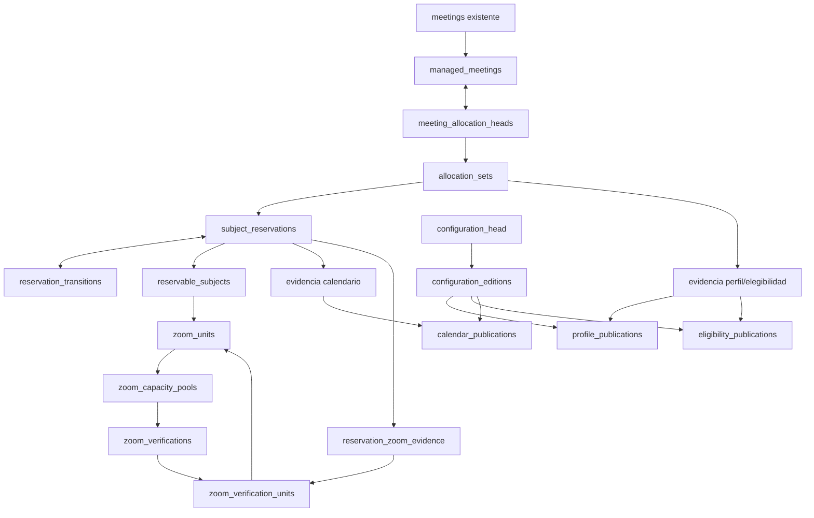

# Contrato físico canónico V2.1 — 4D.4B.2B / 2B.0

Fecha de consolidación local: 2026-11-11 (America/Guayaquil).

**PAQUETE DOCUMENTAL LOCAL PREPARADO — SUJETO A AUDITORÍA INDEPENDIENTE READ-ONLY DEL DIFF.**

**PROPUESTA DE DISEÑO — NO EJECUTAR. 4D.4B.2B: PROPUESTO — NO AUTORIZADO PARA IMPLEMENTACIÓN. 2B.1 NO AUTORIZADO.**

Este documento es la única definición física canónica del paquete 2B.0. Incorpora V2.1, VF-01 y la corrección RVF-01; el [plan de validación](PHASE_4D4B2B_2B0_VALIDATION_PLAN.md) incorpora RVF-02 y el harness. La [revisión de cierre](PHASE_4D4B2B_2B0_CLOSURE_REVIEW.md) conserva procedencia, hallazgos y límites. No hay implementación, pruebas PostgreSQL nuevas, certificación remota ni publicación Git completada por este trabajo.

## Autoridad y fuentes

F0 está publicado en 49192c933e8eb51b362ab8069884392ed2de8f57, rama migracion-vite. Se mantienen [contrato maestro](PHASE_4D4B2_F0_MASTER_CONTRACT.md), [trazabilidad P/D](PHASE_4D4B2_F0_TRACEABILITY.md), [decisiones O, validación y puertas](PHASE_4D4B2_F0_DECISIONS_AND_VALIDATION.md) y [contratos legacy](PHASE_4D_API.md). Los resúmenes no sustituyen las cláusulas F0 ni eliminan P-01…P-41, D-01…D-26 o A2A-01…A2A-14.

Fuente de formalización: autorización humana de opción A, adjunto 377cbeac-ac11-4e10-b2e6-4150945e2bc7/Texto pegado.txt, en el chat 01a1c5f7-0f8e-7ab1-9214-d1b1d0428c35. Autoriza solo estos documentos y el índice técnico, no implementación. La revisión de cierre identifica las fuentes de conversación exactas y su precedencia. V1 y las variantes V2 son antecedentes, no definiciones alternativas vigentes.

Se distinguen: decisiones humanas B/T aprobadas; evidencia del código publicado; especificación física propuesta; pruebas futuras no ejecutadas. PostgreSQL objetivo: 17 en aislamiento identificado y autorizado por separado. No se asume extensión, propietario, ACL ni policy remota.

## Decisiones B aprobadas

| ID | Decisión conservada de F0 | Estado |
|---|---|---|
| B-01 | Identidad de persona | APROBADA — opción A |
| B-02 | Solicitud, reserva y confirmaciones | APROBADA — opción A |
| B-03 | Actor, origen y responsables | APROBADA — opción A |
| B-04 | Selección elegible y segura | APROBADA — opción A |
| B-05 | Usuario único y multirrol | APROBADA — opción A |
| B-06 | Calendarios y buffers | APROBADA — opción A |
| B-07 | Recursos reales | APROBADA — opción A |
| B-08 | Ocupación y resultados | APROBADA — opción A |
| B-09 | Actividad y reasignación | APROBADA — opción A |
| B-10 | Adaptación legacy | APROBADA — opción A |
| B-11 | Históricos y activación | APROBADA — opción A |

## Decisiones T aprobadas

**T-01 — OPCIÓN A**

Identidad común `reservable_subjects`, con exactamente una referencia tipada válida al empleado, sala o unidad Zoom real.

Exigir integridad referencial, coherencia entre `kind` y FK, y unicidad por recurso. Una persona multirrol no duplica sujeto ni capacidad.

No sustituir `internal_users`, `meetings` ni crear identidades humanas paralelas.

**T-02 — OPCIÓN A**

Exclusividad temporal multinivel:

- `tstzrange` semiabierto `[)`.
- Exclusión GiST por sujeto sobre ocupaciones efectivas incompatibles no vacías.
- Bloqueos de sujetos en orden total estable.
- Coordinación incluso sin reservas previas.
- Validación transaccional de conjuntos, calendarios y elegibilidad.
- Atomicidad y rollback ante fallos.

Verificar `btree_gist` posteriormente en aislamiento, sin asumir que está disponible.

No proteger intervalos únicamente mediante `meetings.status`, `now()` o una consulta previa sin coordinación.

**T-03 — OPCIÓN A**

Cada unidad Zoom de concurrencia real verificable es un recurso individual tipado, protegido por T-02.

No equiparar automáticamente cuenta, host, licencia o plan con capacidad.

O-04 sigue pendiente.

Diferenciar reserva PostgreSQL y provisión externa Zoom. El enlace se gestionará después mediante trabajo durable, estado trazable, deduplicación y recuperación.

**T-04 — OPCIÓN A**

Rechazar o no ofrecer límites de calendarios con horas locales ambiguas o inexistentes por DST, salvo desambiguación explícita, autorizada e inequívoca.

Utilizar zonas IANA e instantes absolutos.

No desplazar horas ni escoger offsets silenciosamente.

Preservar la interpretación histórica y los replays de las RPC legacy.

**T-05 — OPCIÓN A**

Conservar inmutable la ocupación original y representar por separado la efectiva.

Liberaciones únicamente futuras, explícitas, auditables y atómicas para los recursos afectados.

Registrar actor, instante, causa y procedencia de política.

COMPLETE y NO_SHOW no liberan anticipadamente.

O-08 sigue pendiente; no elegir duración o fórmula final de buffer residual.

**T-06 — OPCIÓN A**

Coordinar modificaciones ordinarias de calendarios con las reservas existentes mediante locks en orden estable y relectura.

Rechazar cambios que invaliden ocupaciones aceptadas; exigir resolución autorizada y explícita o vigencia futura compatible.

No cancelar, reprogramar o reasignar automáticamente.

Distinguir bloqueo operativo inmediato de emergencia de resolución de citas comprometidas y actualización definitiva.

El mecanismo excepcional requiere especificación posterior.

**T-07 — OPCIÓN A**

Frontera privada de privilegios para los nuevos objetos y operaciones controladas.

No conceder escrituras directas indiscriminadas sobre reservas a `anon`, `authenticated` o al navegador.

Preservar compatibilidad de RPC legacy `SECURITY INVOKER` y sus permisos necesarios.

No revocar permisos históricos indiscriminadamente ni convertir automáticamente todas las RPC a `SECURITY DEFINER`.

Identificar y prevenir bypass mediante escritores directos, scripts, funciones y accesos privilegiados.

Separar el modelo aislado 2B de la futura integración productiva.

## Convenciones canónicas

- Datos: `availability_private`.
- Funciones de entrada: `availability_api`; sin exposición HTTP automática.
- Campos obligatorios salvo `?`.
- `id`: `uuid PK`, excepto singleton y revisiones señalados.
- Generaciones y revisiones: `bigint`; las generaciones y revisiones ordinarias son positivas cuando así lo indica el contrato. La transición inicial de reserva tiene exactamente `reservation_transitions.revision=0`, y su proyección `subject_reservations.state_revision=0` también está permitida: la FK `(id,state_revision)` → `(reservation_id,revision)` es válida para esa revisión inicial. Las transiciones posteriores avanzan consecutivamente desde `1`. No se permiten revisiones negativas. Esta excepción no modifica `version` ni `schedule_revision` de las reuniones legacy.
- Instantes: `timestamptz`; zona conservada como identificador IANA.
- `op`: `operation_id uuid FK availability_operations`.
- Texto identificador: no vacío.
- Estados técnicos: `text` con CHECK de valores permitidos.
- FK sin cascadas destructivas.
- FK ordinaria: inmediata, `RESTRICT`.
- FK circular/proyección expresamente diferible: `NO ACTION DEFERRABLE INITIALLY DEFERRED`.
- `R`: `tstzrange` finito, no vacío, `[)`.
- `E`: vacío o `R`.
- `V`: vigencia no vacía `[)`, inicio finito, fin finito o no acotado.
- CHECK sensibles a NULL deben exigir resultado verdadero; no se acepta que una expresión desconocida valide un estado inválido.
- No existen valores predeterminados de negocio para buffers, duración, horarios, capacidad o exigencia de sala.

Las redundancias de edición, perfil, sujeto y revisión sirven para FK compuestas. No son fuentes editables independientes.

## Inventario físico canónico

Los objetos históricos llevan `op`, salvo `availability_operations`, que es la raíz de esa referencia. No se aplica una regla recursiva de “toda fila referencia otra operación” a la propia operación.

### Infraestructura

| Objeto | Columnas y restricciones |
|---|---|
| `engine_guard` | `id smallint PK CHECK(id=1)`; fila permanente; ausencia implica rechazo |
| `prototype_principals` | `login_name name PK`, `internal_user_id uuid FK`, `can_reserve boolean`, `can_admin boolean`; configuración exclusiva de aislamiento |
| `availability_operations` | `id`, `actor_id uuid FK`, `database_principal name`, `kind text`, `occurred_at timestamptz`, `cutoff_at timestamptz?`, `reason text`, `authorization_ref text`, `policy_ref text?`, `transaction_id xid8` |
| `write_context` | PK `(transaction_id xid8,backend_pid integer)`, `operation_id uuid FK`, `command_kind text`; sin filas persistidas al cierre |
| `configuration_changes` | `id`, `op`, `object_kind text`, `object_key text`, `before_value jsonb?`, `after_value jsonb?`; append-only |

`configuration_changes` es auditoría, no autoridad para resolver relaciones.

### Identidades y recursos

| Objeto | Columnas y restricciones |
|---|---|
| `service_locations` | `id`, `code text UNIQUE`, `name text`, `enabled boolean` |
| `physical_rooms` | `id`, `location_id uuid FK`, `code text`, `name text`; UNIQUE `(location_id,code)` |
| `reservable_subjects` | `id`, `kind text`, `internal_user_id uuid? FK`, `physical_room_id uuid? FK`, `zoom_unit_id uuid? FK`, `enabled boolean`, `state_revision bigint` |
| `zoom_capacity_pools` | `id`, `provider text CHECK='zoom'`, `authority_namespace text`, `capacity_scope_key text`, `identity_method text`, `enabled boolean`, `current_verification_revision bigint?` |
| `zoom_units` | `id`, `pool_id uuid FK`, `canonical_unit_key text`; UNIQUE `(pool_id,canonical_unit_key)` y `(id,pool_id)` |
| `zoom_verifications` | PK `(pool_id uuid,revision bigint)`, `previous_revision bigint?`, `trust_state text`, `proven_capacity integer?`, `valid_during V?`, `evidence_ref text`, `evidence_digest text`, `verifier_id uuid FK`, `verified_at timestamptz`, `op` |
| `zoom_verification_units` | PK `(pool_id,verification_revision,unit_id)`, `independence_evidence_ref text`; FK verificación y FK `(unit_id,pool_id)` |
| `zoom_aliases` | PK `(provider_namespace text,external_scope text,alias_kind text,alias_value text)`, `unit_id uuid`, `pool_id uuid`, `verification_revision bigint`, `op`; FK al miembro del manifiesto |

En `reservable_subjects`:

- Exactamente una FK tipada no nula.
- CHECK de coherencia con `kind`.
- UNIQUE independiente para cada FK.
- UNIQUE `(id,zoom_unit_id)` para evidencia Zoom.
- Identidad y tipo inmutables.

En `zoom_capacity_pools`:

- UNIQUE `(provider,authority_namespace,capacity_scope_key)`.
- FK compuesta del puntero actual a `(pool_id,revision)`.
- El puntero avanza; no retrocede.
- Verificaciones `verified/untrusted/disabled`.
- `verified` exige capacidad positiva, vigencia y manifiesto no vacío.
- Número de unidades manifestadas ≤ capacidad demostrada.
- Los miembros de una verificación solo se insertan durante su creación.

### Configuración

| Objeto | Columnas y restricciones |
|---|---|
| `configuration_editions` | `revision bigint PK`, `previous_revision bigint? FK`, `op`; primera 1, siguientes anterior=`revision−1` |
| `configuration_head` | `id smallint PK CHECK(id=1)`, `revision bigint FK`; avance consecutivo |
| `temporal_policy_revisions` | `id`, `policy_key text`, `revision bigint`, `before_us bigint`, `after_us bigint`, `provenance text`, `op`; UNIQUE clave/revisión; buffers ≥0 |
| `policy_durations` | PK `(policy_id uuid FK,duration_minutes integer)`; duración >0 |
| `requirement_profiles` | `id`, `program_id uuid FK`, `mode text`, `location_id uuid? FK`; UNIQUE NULLS NOT DISTINCT `(program_id,mode,location_id)` |
| `requirement_profile_revisions` | PK `(profile_id uuid,revision bigint)`, `policy_id uuid FK`, `room_min smallint`, `room_max smallint`, `op`; `0≤min≤max≤1` |
| `profile_publications` | `id`, `edition bigint FK`, `profile_id uuid`, `profile_revision bigint`, `valid_during V`, `op`; FK revisión; UNIQUE `(id,edition,profile_id,profile_revision)` |
| `eligibility_publications` | `id`, `edition bigint FK`, `profile_id uuid FK`, `subject_id uuid FK`, `valid_during V`, `op`; sujeto humano obligatorio |
| `calendar_revisions` | `id`, `subject_id uuid FK`, `revision bigint`, `time_zone text`, `op`; UNIQUE `(subject_id,revision)` y `(id,subject_id)` |
| `weekly_windows` | `id`, `calendar_revision_id uuid FK`, `iso_weekday smallint`, `start_local time`, `end_local time`, `end_day_offset smallint` |
| `calendar_exceptions` | `id`, `calendar_revision_id uuid FK`, `kind text`, `during R`, `resolution jsonb`, `reason text`, `op` |
| `calendar_publications` | `id`, `edition bigint FK`, `subject_id uuid`, `calendar_revision_id uuid`, `valid_during V`, `op`; FK revisión/sujeto; UNIQUE `(id,edition,subject_id,calendar_revision_id)` |

Restricciones adicionales:

- Modalidades actuales: `online/phone/office`.
- Ventanas: día 1–7; offset 0/1; duración local positiva y ≤24 h; límites menores que `24:00`; UNIQUE de definición.
- Excepciones: `open/close`.
- EXCLUDE de publicaciones de perfil: `(edition =,profile_id =,valid_during &&)`.
- EXCLUDE de elegibilidad: `(edition =,profile_id =,subject_id =,valid_during &&)`.
- EXCLUDE de calendario: `(edition =,subject_id =,valid_during &&)`.
- UNIQUE de elegibilidad `(id,edition,profile_id,subject_id)` para sus FK de evidencia.

### Reuniones gestionadas y ocupación

| Objeto | Columnas y restricciones |
|---|---|
| `managed_meetings` | `meeting_id uuid PK/FK meetings`, `enrolled_operation_id uuid FK`, `enrolled_at timestamptz`; FK recíproca diferible al head |
| `meeting_allocation_heads` | `meeting_id uuid PK/FK managed_meetings`, `generation bigint`; FK compuesta diferible a set |
| `allocation_sets` | PK `(meeting_id uuid,generation bigint)`, `previous_generation bigint?`, `edition bigint FK`, `profile_id uuid`, `profile_revision bigint`, `policy_id uuid FK`, `program_id uuid FK`, `scheduled_at timestamptz`, `time_zone text`, `duration_minutes integer`, `mode text`, `location_id uuid? FK`, `assigned_to uuid FK`, `human_subject_id uuid FK`, `optional_room_requested boolean`, `op` |
| `allocation_profile_evidence` | PK `(meeting_id,generation,publication_id)`, `edition`, `profile_id`, `profile_revision`, `covered_during R`; FK compuestas a set/publicación |
| `allocation_eligibility_evidence` | PK `(meeting_id,generation,publication_id)`, `edition`, `profile_id`, `subject_id`, `covered_during R`; FK compuestas a set/publicación |
| `subject_reservations` | `id`, `meeting_id uuid`, `generation bigint`, `subject_id uuid FK`, `original_during R`, `effective_during E`, `before_us bigint`, `after_us bigint`, `policy_id uuid FK`, `state_revision bigint`, `op` |
| `reservation_transitions` | PK `(reservation_id uuid,revision bigint)`, `previous_revision bigint?`, `before_effective tstzrange?`, `after_effective E`, `cause text`, `op`; FK propia al anterior |
| `reservation_calendar_evidence` | PK `(reservation_id,publication_id)`, `subject_id`, `edition`, `calendar_revision_id`, `covered_during R`, `accepted_open tstzmultirange`, `resolved_closed tstzmultirange`, `resolution jsonb`, `evaluator_version text`, `tzdb_version text`, `op` |
| `reservation_zoom_evidence` | `reservation_id uuid PK`, `subject_id uuid`, `unit_id uuid`, `pool_id uuid`, `verification_revision bigint`, `op`; FK reserva/sujeto, sujeto/unidad y miembro del manifiesto |

Tipos de las claves repetidas: UUID para identidades; bigint para edición, generación y revisión.

UNIQUE auxiliares de sets:

- `(meeting_id,generation,edition,profile_id,profile_revision)`.
- `(meeting_id,generation,edition,profile_id,human_subject_id)`.
- `(meeting_id,previous_generation)` cuando el predecesor no es nulo.

Reservas:

- FK `(meeting_id,generation)` al set.
- UNIQUE `(meeting_id,generation,subject_id)` y `(id,subject_id)`.
- FK diferible `(id,state_revision)` a transición.
- CHECK `effective_during <@ original_during`.
- EXCLUDE GiST `(subject_id =,effective_during &&)` para efectivos no vacíos.

No se excluyen generaciones antiguas ni estados `completed/no_show/cancelled` del índice temporal.

## Relaciones, inmutabilidad y ciclos de FK

Cardinalidades finales:

- Reunión: cero o una incorporación; una vez incorporada, no se retira.
- Incorporación: exactamente un head y una o más generaciones.
- Generación: una o más reservas, con conjunto exacto según perfil.
- Reserva: una o más transiciones y evidencia completa de calendario.
- Reserva Zoom: exactamente una evidencia de verificación.
- Unidad: un pool y como máximo un sujeto.
- Pool: múltiples verificaciones históricas; como máximo una seleccionada actualmente.

**Orden factible de inserción**

- Incorporación → set → reserva → transición inicial → evidencia → head.
- Las referencias de incorporación a head y de reserva a transición se comprueban diferidamente.
- Head a set también puede diferirse.
- Un pool puede crearse sin verificación actual; después se insertan verificación y miembros y se actualiza su puntero.
- Operación se inserta antes del contexto; esta excepción de infraestructura queda definida en la sección «Seguridad PostgreSQL VF-01».

No hay un ciclo que exija simultáneamente padres inexistentes mediante FK inmediatas.

**Inmutabilidad**

Identidades, sets, originales, políticas copiadas, journals, revisiones, publicaciones y evidencia no admiten UPDATE/DELETE ordinarios.

Los hijos de revisiones/ediciones se insertan exclusivamente en su operación creadora. No basta que exista un contexto cualquiera: debe coincidir su `operation_id` con la creación del padre y ese padre no puede estar ya publicado por una operación anterior.

Los históricos se validan contra sus propios snapshots y publicaciones; solo el set señalado por el head debe corresponder a la logística actual de la reunión.

## Detalle de FK y cadena de generaciones

Las referencias abreviadas del inventario se resuelven por la identidad canónica indicada: actor_id, verifier_id y assigned_to → public.internal_users(id); program_id → public.programs(id); meeting_id de incorporación → public.meetings(id); location_id → service_locations(id); subject_id → reservable_subjects(id); policy_id → temporal_policy_revisions(id); op y enrolled_operation_id → availability_operations(id). Las referencias a reunión/generación siempre usan ambas columnas.

Para allocation_sets: meeting_id referencia managed_meetings; (meeting_id,previous_generation) referencia (meeting_id,generation) del mismo objeto; (profile_id,profile_revision) referencia requirement_profile_revisions. Generación 1 exige predecesor NULL; g>1 exige g-1. Solo se inserta head_actual+1, no se editan/eliminan sets y el head avanza g→g+1. Al COMMIT head=MAX(generation), cadena completa hasta 1 y ningún set huérfano. Agotamiento bigint rechaza, no reinicia.

El predecesor de reservation_transitions incluye reservation_id; revisión 0 exige predecesor/before NULL y after=original; las siguientes enlazan revisión-1. La proyección apunta a la máxima revisión. Se prohíben DELETE de incorporación, head, set, reserva, transición y evidencia. La FK recíproca no se reemplaza por la mera PK del head.

Las FK de evidencia de perfil usan la tupla meeting/generation/edition/profile/revision contra el set y publication/edition/profile/revision contra la publicación. Elegibilidad usa meeting/generation/edition/profile/human_subject y publication/edition/profile/subject. La identidad humana del sujeto coincide con assigned_to por validación. Calendario usa reserva/sujeto y publicación/edición/sujeto/revisión. Zoom usa reserva/sujeto, sujeto/unidad y pool/verificación/unidad del manifiesto.

Estas son explicitaciones de las relaciones ya acordadas, no nuevas entidades. El conjunto completo, cobertura, identidad humana y coherencia con meetings exigen validadores transaccionales, además de FK y CHECK.

## Configuración autoritativa y correspondencia

Cada edición es un conjunto completo de publicaciones. Una edición nueva conserva explícitamente las publicaciones aún aplicables, con nuevos IDs de publicación y referencias a contenido inmutable reutilizable.

No existen ediciones de borrador persistidas en este alcance: construcción, validación y avance del head ocurren en una transacción.

**Selección**

1. Leer la edición vigente bajo la guarda.
2. Resolver programa desde la relación real reunión → solicitud → programa.
3. Resolver ámbito exacto `(programa,modalidad,ubicación)`.
4. Exigir cobertura de todo `[inicio,inicio+duración)` mediante una única revisión de perfil.
5. Admitir publicaciones contiguas de esa misma revisión.
6. Rechazar huecos, ambigüedad y cruce de revisiones diferentes.
7. Validar duración, elegibilidad, recursos, calendarios y capacidad.

`location_id=NULL` significa ausencia de ubicación declarada; no comodín.

La FK del perfil y sus snapshots no autoriza cambiar el programa de una solicitud gestionada por fuera de un comando coordinado. La futura integración debe proteger también esa relación padre.

**Conjunto exacto**

- Un humano; sujeto humano vinculado a `assigned_to`.
- Online: una unidad Zoom verificada.
- Sala: cardinalidad `room_min/room_max`, ubicación compatible.
- Sala opcional: requiere `optional_room_requested=true`.
- No se añaden otros recursos ni capacidad de la agendadora por su autoría.
- O-05 determina los valores concretos de sala.
- O-06 determina selección automática; el prototipo solo contempla selección explícita autorizada.

Las FK compuestas de evidencia fuerzan edición/perfil/revisión/sujeto correspondientes al set. El validador verifica además cobertura temporal y correspondencia con la reunión.

**Cambios posteriores**

- Calendarios/perfiles: una edición ordinaria nueva no puede invalidar ocupación efectiva futura ya aceptada.
- Actividad/elegibilidad: su retirada bloquea nuevas admisiones, sin borrar aceptación histórica.
- Los validadores finales no exigen que una reserva anterior use el head de configuración actual.
- Si en una misma transacción se reserva y luego se publica configuración, la publicación debe comprobar esa reserva recién creada.

La completitud no significa que todos los sujetos tengan disponibilidad: la ausencia de publicaciones produce indisponibilidad explícita.

## Calendarios, DST y evidencia

La regla permanece:

`disponible = (horario habitual ∪ aperturas) − cierres`

Por reserva y publicación:

`covered_during = original_during ∩ valid_during`

Esa intersección, cuando no es vacía, es un único rango. Por eso no se conserva `piece_no`.

Se exige:

- FK compuesta reserva/sujeto.
- FK compuesta publicación/edición/sujeto/revisión.
- Edición igual a la del set.
- Tramos no solapados mediante EXCLUDE por reserva y `covered_during`.
- Unión de tramos exactamente igual al original.
- Cada tramo contenido en apertura efectiva y sin intersección con cierres.
- Evaluación reproducible a partir de revisión, resoluciones y versión del evaluador.

Una revisión publicada varias veces produce varias filas de publicación y, si corresponde, varias filas de evidencia.

Las ventanas nocturnas se resuelven sobre fechas locales concretas. Los límites ambiguos necesitan desambiguación explícita y autorizada; los inexistentes requieren corrección explícita o rechazo. Un cierre ambiguo no desaparece.

La evidencia guarda versión tzdb y resoluciones absolutas. No se promete que PostgreSQL proporcione por sí solo una etiqueta tzdb portable: el futuro evaluador debe recibir una identificación verificable de su entorno, sin aceptar una etiqueta inventada por el cliente.

La evidencia aceptada no se reescribe por cambios de calendario o tzdb.

## Identidad y capacidad Zoom

Se adopta **verificación por pool con manifiesto relacional**, porque permite declarar qué unidades se consideran independientes dentro del mismo conjunto de capacidad.

Una lista `text[]` no permite las mismas FK por miembro; queda sustituida por `zoom_verification_units`.

**Admisión de una reserva Zoom**

Deben cumplirse conjuntamente:

1. Pool habilitado.
2. Sujeto habilitado.
3. Verificación actual `verified`.
4. Instante de aceptación y ocupación prevista cubiertos por su vigencia.
5. Unidad presente en el manifiesto de esa verificación.
6. Evidencia de independencia identificada.
7. Calendario y exclusión temporal satisfechos.
8. Evidencia de la verificación usada persistida en la reserva.

**Alias**

- Solo alias que identifican inequívocamente una unidad.
- Cuenta/host compartido no se convierte en alias exclusivo de unidad.
- Alias desconocido no crea recurso automáticamente.
- Alias nuevo de una unidad existente no crea otra unidad.
- Reutilización ambigua de un alias obliga a detener su resolución automática.
- Cambiar host/cuenta no duplica capacidad por defecto.

**Garantías y límites**

| PostgreSQL puede garantizar | Necesita evidencia externa |
|---|---|
| Unicidad del identificador canónico registrado | Que el identificador representa capacidad real |
| Unidad perteneciente al pool declarado | Que dos pools no describen capacidad física solapada |
| Miembro presente en verificación concreta | Independencia real de las unidades |
| Cantidad registrada no superior a capacidad acreditada en el registro | Veracidad y vigencia de esa acreditación |
| Un sujeto por unidad y exclusión temporal | Condiciones comerciales/técnicas de Zoom |

Si el proveedor no ofrece identificador directo, el registro interno debe vincularse a evidencia comprobable y revisión humana O-04. Enumerar unidades nunca constituye prueba de concurrencia.

Deshabilitar cambia admisión futura, no reservas ni historia. Reserva local y provisionamiento externo permanecen separados; no se crea Zoom en 2B.0.

## Guarda global, locks y concurrencia

**Orden canónico**

| Nivel | Objeto | Modo |
|---|---|---|
| E | `engine_guard(id=1)` | `FOR UPDATE` |
| L0 | Idempotencia del contrato | Advisory transaccional existente, cuando corresponda |
| L1 | Actor/usuarios pertinentes | `FOR SHARE`; objetivo administrativo `FOR UPDATE` |
| L2 | Solicitud padre | `FOR UPDATE` |
| L3 | Reunión, incorporación/head existentes | `FOR UPDATE` |
| L4 | Head de configuración | SHARE para reserva; UPDATE para publicación |
| L5 | Unión de sujetos anteriores/nuevos | `FOR UPDATE`, UUID ascendente |
| L6 | Reservas/proyecciones mutables | `FOR UPDATE`, orden estable |

La guarda se adquiere antes de locks de filas de dominio, advisory legacy y escrituras. No significa que PostgreSQL deje de tomar locks internos de catálogo/relación necesarios para ejecutar SQL.

| Operación | Recorrido después de E |
|---|---|
| CREATE | Prefijo de autorización/idempotencia → usuarios → padre → configuración → sujetos → creación completa |
| RESCHEDULE | Prefijo publicado → padre/reunión/head → configuración → sujetos antiguos/nuevos → reservas |
| CANCEL | Prefijo publicado → padre/reunión/head → sujetos/reservas → corte y transición admitida |
| COMPLETE | Prefijo propio → padre/reunión → comprobación final; sin reducción |
| NO_SHOW | Prefijo propio y umbral propio → padre/reunión; sin reducción |
| Calendarios/perfiles | Actor → configuración → sujetos afectados → lectura de ocupaciones; sin locks tardíos de reunión |
| Actividad | Actor/objetivo → sujetos → estado y auditoría |
| Elegibilidad | Actor/usuarios → configuración → sujetos |
| Reasignación | Mecanismo preparado; entrada operativa no habilitada hasta O-18 |
| Emergencia | Sin entrada habilitada; requiere contrato separado |
| Validadores diferidos | SELECT sin nuevos locks explícitos de filas ni escrituras |

**Prueba del argumento de serialización**

Entre escritores conformes:

- A supera E y puede mantener U/M/G/S.
- B espera E antes de adquirir esos locks.
- B no puede mantener G esperando M de A, ni U esperando G de A, ni S2 esperando S1 de A.
- Las comprobaciones FK se ejecutan después de E.
- Los validadores no añaden nuevas dependencias explícitas de locking.

La demostración depende de que **todos los escritores del dominio participen**. No cubre scripts, mantenimiento, escritores legacy no adaptados ni consumidores externos que ya tengan locks.

**Varias llamadas en una transacción**

Se admiten llamadas controladas sucesivas. La primera mantiene E; las siguientes reutilizan su posesión. Cada llamada deja contexto vacío y estado estructuralmente válido.

No se admite composición con locks manuales o DML externo sobre el dominio. Tampoco llamadas desde sentencias que ya hayan adquirido locks incompatibles fuera del protocolo.

Los roles ordinarios del prototipo no reciben acceso a tablas que permita esas composiciones.

Si se revierte un savepoint anterior a la adquisición de la guarda, PostgreSQL puede liberar los locks adquiridos después de él. Las escrituras correspondientes también se revierten; la siguiente llamada debe adquirir E otra vez. No se mantiene una bandera de aplicación que afirme falsamente seguir poseyéndola. [Locks y savepoints](https://www.postgresql.org/docs/17/explicit-locking.html).

**Timeout/deadlock/error**

- No se transforma timeout, deadlock o error de constraint en éxito.
- Se revierte la operación completa.
- No se reintenta automáticamente solo su último INSERT.
- Intento incierto conserva clave/payload/contrato idempotente.
- Tras espera se relee bajo READ COMMITTED.
- Cambios inesperados en recursos descubiertos provocan reinicio completo, no adquisición hacia atrás.

**Límites de producción**

La guarda única limita throughput y permite bloqueo en cadena por transacciones largas. No habrá llamadas externas dentro de ella. Una futura optimización por múltiples guardas exige otra demostración; no se declara segura por ordenar UUID.

## Original, efectivo y transiciones

Para cada sujeto:

`original = [scheduled_at − before_us, scheduled_at + duración + after_us)`

Cálculo exacto, con finitud y rechazo de overflow; sin redondeo silencioso de bigint a coma flotante.

**Creación**

- Revisión 0.
- `before_effective=NULL`.
- `after_effective=original`.
- `effective=original`.
- `state_revision=0`.

**Transición posterior**

- Revisión anterior exacta `r−1`.
- `before_effective` igual al último `after_effective`.
- Proyección igual al último `after_effective`.
- Efectivo nuevo contenido en anterior.
- No borrar ocupación anterior al corte.
- Corte de DB posterior a esperas, común a los recursos de la operación.
- Si el reloj produce una secuencia incompatible con el historial, rechazo; no corregir tiempos silenciosamente.

**Alcance continuo**

Se conserva un único rango efectivo. Reducciones permitidas estructuralmente son prefijos continuos o vacío, siempre con autorización aplicable.

- Antes de comenzar toda ocupación, puede vaciarse mediante cancelación/sustitución autorizada.
- Una vez iniciada ocupación —incluido buffer previo—, la liberación residual permanece no habilitada mientras O-08 siga pendiente.
- No se habilitan huecos interiores.
- No se inventa retención cero ni fórmula residual.
- COMPLETE/NO_SHOW no escriben transiciones de liberación.
- La expiración temporal no requiere escritura.
- Generaciones sustituidas siguen participando en EXCLUDE.
- Si una reserva nueva intersecta un buffer retenido, se rechaza.

Reprogramación idéntica conserva asignación si no cambia el conjunto; no produce generaciones ficticias. Su `version` y auditoría siguen el contrato legacy.

## Validadores y cobertura de mutaciones

| Grupo | INSERT | UPDATE | DELETE | Cierre/concurrencia |
|---|---|---|---|---|
| Incorporación/head | Alta atómica | Head solo `g→g+1` | Prohibido | FK recíproca diferida; head=max generación |
| Sets | Solo siguiente generación | Prohibido | Prohibido | Cadena misma reunión hasta 1 |
| Reservas | Set completo | Solo efectivo/revisión mediante transición | Prohibido | EXCLUDE + validador de conjunto |
| Transiciones | Consecutivas | Prohibido | Prohibido | Proyección=última; pasado conservado |
| Configuración publicada | Solo operación creadora | Prohibido | Prohibido | Edición completa, ámbito y vigencias |
| Evidencias | Solo aceptación autorizada | Prohibido | Prohibido | FK compuestas y cobertura exacta |
| Recursos/actividad | Alta controlada | Campos habilitados y auditados | Sin borrado de identidades usadas | E y relectura |
| Operación/contexto | Arranque especial | Operación inmutable | Solo retirada de contexto | Contexto vacío al cierre |
| Relaciones legacy gestionadas | Comando coordinado | Protección de OLD/NEW | Restricción por incorporación | Integración obligatoria antes de activar |

Los validadores de UPDATE comprueban claves antiguas y nuevas; DELETE comprueba las antiguas aunque la fila ya no exista.

Los triggers diferibles son `AFTER ROW`. `TRUNCATE` se prohíbe por ACL y trigger de sentencia separado. No se confunden eventos diferidos de fila con tablas de transición. [Documentación de triggers](https://www.postgresql.org/docs/17/sql-createtrigger.html).

Índices:

- PK/UNIQUE B-tree.
- FK indexadas cuando no estén cubiertas.
- GiST de exclusión temporal.
- B-tree de reservas por set/sujeto y journals por reserva/revisión.
- Evidencia por publicación, verificación y operación.
- Sin predicados temporales basados en `now()` ni lifecycle.

`btree_gist` y compatibilidad de PostgreSQL 17 deben comprobarse en aislamiento autorizado.

## Responsabilidad, índices y dependencias por objeto

La matriz ACL de la sección de seguridad identifica para cada objeto su escritor: kernel únicamente a través de entradas controladas; validator solo lectura; runtime/admin solo EXECUTE. Owner instala la infraestructura en una autorización futura y no es un escritor ordinario. La política general de inmutabilidad y las excepciones por columna de esa matriz se aplican conjuntamente.

| Objetos del inventario | Dependencias normativas |
|---|---|
| engine_guard, operaciones, contexto, cambios, principales | B-03/B-10; T-02/T-07; F-03/F-05; VF-01 |
| ubicaciones, salas, sujetos, usuarios existentes | B-04/B-05/B-07/B-09; T-01/T-02; O-05/O-09 |
| pools, unidades, verificaciones, manifiestos y alias Zoom | B-07; T-03; F-04; O-04 |
| ediciones/head, políticas/duraciones, perfiles/publicaciones, elegibilidad | B-04/B-06; T-02/T-06; F-02; O-01/O-02/O-05/O-06 |
| revisiones, ventanas, excepciones y publicaciones de calendario | B-06; T-04/T-06; F-07; O-01 |
| incorporación, head de asignación y sets | B-09/B-10/B-11; T-02; F-01; O-15/O-18 |
| reservas y transiciones | B-08; T-02/T-05; F-06; O-08 |
| evidencias de perfil/elegibilidad/calendario/Zoom | B-04/B-06/B-07; T-02/T-03/T-04; F-02/F-04/F-07 |

Índices comunes: B-tree de PK/UNIQUE y FK no cubiertas; reservas por set/sujeto; transiciones por reserva/revisión; evidencia por publicación, revisión, verificación y operación; GiST de exclusiones y rangos cuando corresponde. Las políticas técnicas de seguridad no sustituyen las comprobaciones de negocio ni prueban permisos efectivos.

## Seguridad PostgreSQL VF-01

**PROPUESTA — NO EJECUTAR.** Esta sección integra la cláusula corregida completa y sustituye la matriz de seguridad preliminar de V2.1. No crea roles, grants ni policies.

### Cláusula canónica VF-01 para incorporar a V2.1

**VF-01.1 — Alcance y principio de autorización**

La configuración descrita se aplicaría exclusivamente en un PostgreSQL aislado, después de autorización independiente.

Toda operación necesita simultáneamente:

1. Acceso al esquema.
2. ACL de tabla, columna o función.
3. Policy RLS aplicable cuando la tabla tenga RLS habilitado.
4. Autorización del comando.
5. Triggers, constraints y validadores de V2.1.

Una policy no concede por sí sola un GRANT ausente. Un GRANT no evita RLS. La autorización empresarial continúa en las funciones controladas; no se traslada a una policy genérica accesible por usuarios finales. [RLS de PostgreSQL](https://www.postgresql.org/docs/17/ddl-rowsecurity.html).

**VF-01.2 — Propiedad y roles**

| Rol | Propiedad propuesta | Restricciones |
|---|---|---|
| `availability_owner` | Esquemas y tablas nuevas | NOLOGIN; sin membresía asumible por roles ordinarios |
| `availability_kernel` | Funciones escritoras controladas y sus helpers | NOLOGIN, NOSUPERUSER, NOBYPASSRLS; no propietario de tablas |
| `availability_validator` | Validadores diferidos y funciones de validación de solo lectura | NOLOGIN, NOSUPERUSER, NOBYPASSRLS; no propietario de tablas |
| `availability_runtime` | Ningún objeto | Solo EXECUTE de entradas de reserva/lectura autorizadas |
| `availability_admin` | Ningún objeto | Solo EXECUTE de entradas administrativas/lectura autorizadas |

Las tablas existentes conservan su propietario en la copia aislada. El propietario efectivo debe inventariarse antes de configurar el entorno; no se deduce del texto `CREATE TABLE` de una migración.

Kernel y validator no pueden ser propietarios de esas tablas ni miembros del rol propietario. Tampoco pueden asumir `service_role`.

NOLOGIN no se considera una defensa suficiente: se verifica la clausura de membresías, herencia y capacidad de SET ROLE. Los logins de prueba solo pueden asumir los roles ordinarios necesarios, nunca owner/kernel/validator.

**VF-01.3 — Estado RLS**

- **Tablas nuevas:** RLS habilitado y `FORCE ROW LEVEL SECURITY`.
- **Tablas existentes consultadas:** RLS permanece habilitado. Se conserva su estado FORCE de la copia autorizada y se registra expresamente.
- No se desactiva RLS para hacer funcionar el prototipo.
- Kernel y validator están sujetos a RLS, independientemente de FORCE, porque no son propietarios ni tienen bypass.
- FORCE hace que el propietario también esté sujeto a RLS en sus accesos ordinarios. No impide que un propietario privilegiado altere el esquema o las policies; mantenimiento queda fuera de la frontera ordinaria.
- No se añade una policy general para el propietario. La instalación y cualquier mantenimiento requieren un procedimiento separado.

La presencia de policies heredadas de la copia se inspecciona antes de añadir las nuevas; no se presupone que sean compatibles.

### Inventario y matriz ACL por clase de objeto

Notación:

- `S`: SELECT.
- `I`: INSERT.
- `U(...)`: UPDATE exclusivamente de las columnas indicadas.
- `D`: DELETE.
- `L(columna)`: privilegio UPDATE de esa columna necesario para locking; no autoriza una modificación funcional.
- `—`: sin concesión.

Para **todas las filas siguientes**, runtime y admin carecen de SELECT y DML directo. Tampoco reciben TRUNCATE, REFERENCES, TRIGGER, propiedad ni capacidad de alterar policies.

### Objetos nuevos

Todos pertenecen a `availability_owner`; RLS habilitado y FORCE activado.

| Clase y objetos | Kernel | Validator |
|---|---|---|
| `engine_guard` | S, L(`id`) | S |
| `prototype_principals` | S | S |
| `availability_operations` | S, I | S |
| `write_context` | S, I, D | S |
| `configuration_changes` | S, I | S |
| `service_locations` | S, I, U(`name`,`enabled`) | S |
| `physical_rooms` | S, I, U(`name`) | S |
| `reservable_subjects` | S, I, U(`enabled`,`state_revision`) | S |
| `zoom_capacity_pools` | S, I, U(`enabled`,`current_verification_revision`) | S |
| `zoom_units`, `zoom_verifications`, `zoom_verification_units`, `zoom_aliases` | S, I | S |
| `configuration_editions` | S, I | S |
| `configuration_head` | S, U(`revision`) | S |
| `temporal_policy_revisions`, `policy_durations` | S, I | S |
| `requirement_profiles`, `requirement_profile_revisions` | S, I | S |
| `profile_publications`, `eligibility_publications` | S, I | S |
| `calendar_revisions`, `weekly_windows`, `calendar_exceptions`, `calendar_publications` | S, I | S |
| `managed_meetings` | S, I, L(`meeting_id`) | S |
| `meeting_allocation_heads` | S, I, U(`generation`) | S |
| `allocation_sets` | S, I | S |
| `allocation_profile_evidence`, `allocation_eligibility_evidence` | S, I | S |
| `subject_reservations` | S, I, U(`effective_during`,`state_revision`) | S |
| `reservation_transitions` | S, I | S |
| `reservation_calendar_evidence`, `reservation_zoom_evidence` | S, I | S |

Precisiones:

- Las filas singleton y los mapeos iniciales de `prototype_principals` pertenecen a la instalación autorizada; no los crea el runtime.
- Los cambios descriptivos indicados siguen exigiendo comando administrativo y auditoría. Identidades, códigos canónicos y relaciones históricas permanecen protegidos.
- INSERT en objetos append-only no permite añadir hijos a una revisión ya cerrada: lo impiden los controles de V2.1.
- Validator no recibe INSERT, UPDATE, DELETE ni privilegios destinados a locks.
- Kernel no recibe DELETE fuera de `write_context`.
- Ningún rol ejecutor recibe TRUNCATE.

### Esquemas y funciones

| Rol | `availability_private` | `availability_api` | `public` | Funciones |
|---|---|---|---|---|
| Kernel | USAGE | USAGE | USAGE | Sus funciones y helpers expresamente autorizados |
| Validator | USAGE | Sin necesidad en el diseño canónico | USAGE | Validadores y helpers de lectura necesarios |
| Runtime | Sin USAGE | USAGE | Ningún USAGE adicional por esta cláusula | Entradas de reserva/lectura, por firma |
| Admin | Sin USAGE | USAGE | Ningún USAGE adicional por esta cláusula | Entradas administrativas/lectura, por firma |

Los validadores y helpers internos se sitúan en `availability_private`. No se conceden permisos sobre “todas las funciones presentes y futuras” de un esquema.

Los permisos ya existentes de otros roles no se modifican por inferencia. En el entorno aislado se comprueba que PUBLIC o membresías heredadas no añadan acceso imprevisto a los roles ordinarios.

### Matriz RLS canónica

Las siguientes policies son **contrato textual**, no SQL para ejecutar.

Cada tabla utiliza únicamente las policies que corresponden a sus ACL anteriores:

| Policy lógica | Rol destinatario | Comando | USING | WITH CHECK |
|---|---|---|---|---|
| `vf01_kernel_select` | Kernel | SELECT | `true` | No aplica |
| `vf01_validator_select` | Validator | SELECT | `true` | No aplica |
| `vf01_kernel_insert` | Kernel | INSERT | No aplica | `true` |
| `vf01_kernel_update` | Kernel | UPDATE | `true` | `true` |
| `vf01_kernel_delete` | Kernel | DELETE | `true` | No aplica |

Reglas:

1. SELECT existe para kernel y validator en cada tabla enumerada.
2. INSERT existe solo donde kernel tiene I.
3. UPDATE existe solo donde kernel tiene U o L.
4. DELETE existe exclusivamente en `write_context`.
5. No se crean policies dirigidas a PUBLIC, runtime, admin, `anon` o `authenticated`.
6. No se usa `FOR ALL` como sustituto de esta matriz.
7. No hay filtros por actor, reunión o contexto en las policies técnicas de lectura.
8. Los límites por columna los impone ACL; los límites por operación, identidad e inmutabilidad los imponen las funciones y triggers.
9. No se admiten policies restrictivas aplicables a kernel/validator que reduzcan la visibilidad requerida.

Estas policies permiten acceso completo **a roles internos no asumibles por el llamador**. No dan escritura directa a usuarios finales.

Para UPDATE se necesita visibilidad SELECT de las filas, además de la policy UPDATE y sus dos condiciones. `USING` restringe filas existentes; `WITH CHECK` valida el estado nuevo. [CREATE POLICY](https://www.postgresql.org/docs/17/sql-createpolicy.html).

**Guarda transaccional**

Kernel recibe:

- USAGE del esquema.
- SELECT de `engine_guard`.
- UPDATE de la columna `id`.
- Policies SELECT y UPDATE anteriores.

Así puede adquirir `FOR UPDATE`. Un trigger inmediato rechaza cualquier UPDATE real —incluso un no-op— y cualquier DELETE de la fila. La cláusula de locking no ejecuta un UPDATE de la fila ni dispara ese trigger.

La fila debe existir exactamente una vez. Si falta, se genera error; nunca se interpreta como “guarda libre”. [Permisos de SELECT con locking](https://www.postgresql.org/docs/17/sql-select.html).

### Acceso a dependencias existentes en aislamiento

Las tablas conservan su esquema y relaciones reales. Los datos de prueba se crean únicamente mediante fixtures autorizados posteriormente, utilizando esas identidades y FK; no se crea un catálogo paralelo de empleados.

| Tabla existente | Kernel | Validator | Policies nuevas del aislamiento |
|---|---|---|---|
| `public.internal_users` | S; U(`active`,`updated_at`) para comando administrativo | S | SELECT K/V; UPDATE K |
| `public.consultation_requests` | S; U(`status`,`updated_at`) para el flujo aislado autorizado | S | SELECT K/V; UPDATE K |
| `public.programs` | S | S | SELECT K/V |
| `public.destinations` | Sin acceso requerido por el núcleo temporal | Sin acceso requerido | Ninguna |
| `public.program_destinations` | Sin acceso requerido por el núcleo temporal | Sin acceso requerido | Ninguna |
| `public.meetings` | S; INSERT y UPDATE limitados según detalle siguiente | S | SELECT K/V; INSERT/UPDATE K |
| `public.audit_events` | S para contraste histórico | S | SELECT K/V |
| `public.idempotency_records` | S para contraste/replay en escenarios autorizados | S | SELECT K/V |

Las escrituras del prototipo en su journal nuevo usan `availability_operations` y las tablas propias. Esta cláusula **no concede nuevas escrituras de contratos legacy** en auditoría o idempotencia. Los ensayos de workflows legacy utilizan sus roles y contratos existentes en la fase de integración correspondiente.

**Columnas de meetings**

INSERT permitido para:

`id`, `consultation_request_id`, `scheduled_at`, `time_zone`, `duration_minutes`, `mode`, `status`, `notes`, `assigned_to`, `created_by`, `updated_by`, `version`, `booked_by`, `role_at_booking`, `booking_attribution_source`, `schedule_revision`.

Los timestamps con default se dejan a la definición existente.

UPDATE permitido para:

`scheduled_at`, `time_zone`, `duration_minutes`, `mode`, `status`, `assigned_to`, `updated_by`, `updated_at`, `version`, `schedule_revision`.

No se concede UPDATE general de tabla ni de `id`, `consultation_request_id`, `created_by`, `booked_by`, atribución o notes mediante esta cláusula. Los contratos especializados de notas/atribución permanecen separados.

Los grants de columnas permiten técnicamente la operación; no eliminan sus precondiciones ni habilitan reasignación antes de O-18.

**Otros límites**

- Kernel no inserta usuarios ni solicitudes de prueba: los prepara el harness autorizado.
- No necesita acceso directo a `auth.users`; la preparación de sus FK corresponde al harness.
- No necesita acceso a secretos o credenciales.
- Si una función incorpora una dependencia adicional, esta debe añadirse expresamente al inventario antes de habilitarla; no se amplía acceso a todo `public`.
- No se editan migraciones históricas. Cualquier configuración futura se incorpora por un mecanismo nuevo y autorizado.
- No se propone aplicar estas policies en producción. Allí se requiere preflight remoto, inventario de policies/escritores y autorización independiente.

### Contrato de validadores diferidos

### Identidad y alcance de lectura

Cada función de validación diferida es `SECURITY DEFINER`, propiedad de `availability_validator`, sin DML ni adquisición de nuevos locks explícitos.

| Validador | Tablas necesarias |
|---|---|
| Incorporación/head/generaciones | `managed_meetings`, heads, sets, reservas, `public.meetings`, solicitudes y programas |
| Completitud y perfil | Sets, sujetos, recursos, perfiles, políticas, duraciones, publicaciones, evidencia de perfil/elegibilidad, usuarios y reuniones |
| Transiciones | Reservas, transiciones, operaciones, sets y heads |
| Calendario/evidencia | Reservas, sets, ediciones, publicaciones, revisiones, ventanas, excepciones y evidencia |
| Zoom | Sujetos, pools, unidades, verificaciones, manifiestos, alias y evidencia de reserva |
| Contexto final | `write_context` y operación identificada por el evento |
| Configuración administrativa | Ediciones/head, publicaciones, contenido referenciado, ocupaciones pertinentes y cambios auditados |

El SELECT del validator no se limita al actor actual. Debe poder comprobar conflictos, recursos compartidos y filas relacionadas creadas por otros actores.

### Detección de visibilidad incompleta

Se añade un helper interno de solo lectura, conceptualmente `assert_security_contract()`, sin tabla nueva.

Antes de consultar invariantes, el validador verifica en catálogos:

- Rol efectivo esperado.
- Ausencia de SUPERUSER/BYPASSRLS y propiedad de tablas.
- USAGE y SELECT necesarios.
- Estado RLS/FORCE esperado.
- Policy SELECT permisiva dirigida explícitamente al validator con expresión constante `true`.
- Ausencia de policies restrictivas SELECT/ALL aplicables mediante PUBLIC o membresías.
- Ausencia de definiciones desconocidas que alteren el contrato de visibilidad.
- Propietario, modo de seguridad y configuración segura de sus helpers.

La inspección usa objetos conocidos por nombre cualificado/OID y un inventario fijo del contrato. No ejecuta expresiones de policies recibidas como texto ni consulta secretos.

Una policy ausente, alterada o no reconocida provoca error de contrato de seguridad **antes** de evaluar la integridad del dominio. No se acepta un nombre de policy como evidencia suficiente: se comprueban destinatarios, comando, carácter permisivo/restrictivo y expresión.

Estos atributos están representados en `pg_policy`. [Catálogo oficial](https://www.postgresql.org/docs/17/catalog-pg-policy.html).

El kernel aplica una comprobación equivalente de sus permisos y policies antes del acceso de dominio. Esta inspección de catálogo puede preceder a la guarda; no adquiere locks de filas de usuarios, reuniones o reservas.

### Cero filas no equivale a validez

Después de comprobar el contrato de seguridad:

- Si una relación requerida devuelve cero filas, se rechaza.
- Se exige cardinalidad positiva cuando corresponde: head, set, humano, transición inicial y evidencia.
- No se acepta como prueba suficiente un `NOT EXISTS` sobre un conjunto que podría estar vacío.
- Las cardinalidades opcionales siguen las reglas del perfil, no una tolerancia genérica.
- Si falla la comprobación de seguridad, nunca se interpreta el resultado como recurso inexistente, sin conflictos o conjunto completo.

No se usa `row_security=off` para intentar eludir RLS.

### Independencia del contexto

Los validadores:

- Utilizan los identificadores OLD/NEW del evento y hechos persistidos.
- No exigen una fila activa de `write_context`.
- No usan el contexto como condición RLS.
- Comprueban al cierre que el contexto de la transacción/backend haya sido retirado.
- Conservan acceso mediante su identidad efectiva propia, aunque la función escritora ya haya retornado.

Las funciones de validación exigen `current_user=availability_validator`. Sus helpers `SECURITY INVOKER` heredan esa identidad. Si se invocan desde el kernel para validación anticipada, el wrapper DEFINER cambia temporalmente al validator y retorna después al kernel.

### Límite de esta comprobación

Detectar divergencias de catálogo protege frente a instalación incompleta o cambios accidentales del entorno. No promete resistencia frente a un superusuario o propietario malicioso capaz de sustituir simultáneamente policies y funciones.

En el entorno de prueba no se permiten cambios privilegiados de esquema mientras se ejecutan los ensayos de concurrencia.

### Funciones privilegiadas, helpers y contexto privado

**Matriz de ejecución**

| Familia | Propietario / seguridad | Quién puede ejecutar |
|---|---|---|
| Entradas de reserva y lectura autorizada | Kernel / DEFINER | Runtime; admin solo para las entradas que también le correspondan |
| Entradas administrativas | Kernel / DEFINER | Admin |
| Helpers internos de escritura/autorización | Kernel / INVOKER | Kernel; sin acceso de llamadores |
| Validadores callable de solo lectura | Validator / DEFINER | Kernel para comprobación anticipada y funciones de validación |
| Trigger functions diferidas | Validator / DEFINER | Invocación por triggers; sin concesión de ejecución directa a llamadores |
| Helpers de validación | Validator / INVOKER | Validator |
| Comprobación de catálogo de seguridad | Rol técnico designado / INVOKER, solo lectura | Kernel y validator |
| Guardas inmediatas | INVOKER | Invocación por triggers; verifican identidad efectiva kernel |

Para cada función se registrarán firma exacta, propietario, modo de seguridad y dependencias antes de cualquier futura instalación. No se concederá EXECUTE por patrón de nombre.

**Reglas comunes**

- EXECUTE revocado de PUBLIC al crear funciones.
- Default privileges del rol creador también configurados para no otorgar EXECUTE público a funciones futuras.
- Grants expresos por firma.
- `search_path=pg_catalog,pg_temp`.
- Todas las tablas, funciones auxiliares y demás objetos de aplicación referenciados con esquema.
- Sin SQL dinámico procedente del cliente.
- `row_security=on` en las funciones privilegiadas.
- USAGE en los esquemas que efectivamente referencian.
- Ninguna función escritora propiedad de owner ni de `service_role`.
- Helpers sin elevación adicional salvo wrappers de validación expresamente declarados.

`SECURITY DEFINER` ejecuta con los privilegios de su propietario, incluidos sus límites RLS; no concede acceso automático a las funciones que ese propietario llama. [CREATE FUNCTION](https://www.postgresql.org/docs/17/sql-createfunction.html).

**Identidad del llamador**

- `session_user`: login dedicado del prototipo.
- `current_user`: kernel o validator durante las respectivas funciones.
- Actor humano: mapeo autorizado de `prototype_principals(session_user)`.
- No se confía en un parámetro libre, GUC o nombre de rol para suplantar al actor.
- El mapeo se consulta bajo RLS; kernel no puede modificarlo.
- No se extrapola esta solución a una conexión productiva compartida.

**Bootstrap del contexto**

Se conserva la secuencia V2.1:

1. Comprobar seguridad y adquirir la guarda.
2. Autorizar y resolver replay conforme al contrato.
3. Para intento nuevo, insertar operación.
4. Insertar contexto que referencia la operación.
5. Ejecutar escrituras controladas.
6. Validar.
7. Eliminar contexto.
8. Retornar y completar validación diferida.

Las policies INSERT de operación/contexto y DELETE de contexto no consultan `write_context`. Por ello no crean una dependencia circular.

Las guardas de infraestructura verifican:

- Ejecución como kernel.
- Sesión, backend y transacción correctos.
- Correspondencia con la operación.
- Ausencia de contexto previo incompatible.
- Eliminación únicamente del contexto propio.

Una función ordinaria no exporta ni devuelve una capacidad reutilizable para abrir contexto. Runtime/admin no pueden insertar, borrar o falsificarlo.

## Dependencia RVF-01 y ajuste de permisos

### Corrección contractual exacta de RVF-01

Texto propuesto para añadir a la cláusula de seguridad V2.1:

> **Dependencia implícita de meetings: `public.utf16_length(text)`.**
>
> El constraint `public.meetings.meetings_notes_utf16_length_valid` depende de `public.utf16_length(text)`. Por ello, en el futuro PostgreSQL aislado autorizado, `availability_kernel` necesitará EXECUTE sobre esa firma exacta, además de los permisos de esquema, tabla, columnas y policies ya especificados.
>
> La concesión requiere autorización de implementación independiente. Esta cláusula no ejecuta ni autoriza actualmente ningún GRANT.
>
> Se conservarán la definición, propietario, firma y condición `SECURITY INVOKER` de la función existente. No se modificarán el constraint ni su límite de 2000 unidades UTF-16.
>
> No se concederá EXECUTE adicional a `availability_runtime`, `availability_admin`, `anon` ni `authenticated`. Los permisos actuales de `service_role` permanecerán intactos. No se concederá EXECUTE general sobre el esquema `public`, membresía privilegiada ni BYPASSRLS.
>
> La firma se incorporará al inventario de dependencias y a `assert_security_contract()`. Posteriormente se verificará con INSERT y UPDATE reales de reuniones sintéticas, exclusivamente en un entorno y mediante pruebas expresamente autorizados.
>
> El permiso permite evaluar la función requerida por el CHECK; no autoriza a omitir controles, modificar notas fuera del comando permitido ni eludir RLS.

Evidencia: [definición y permisos de la función](../supabase/migrations/20261022010000_meeting_context_schema.sql#L12) y [CHECK que la invoca](../supabase/migrations/20261022010000_meeting_context_schema.sql#L64).

### Ajuste mínimo de la matriz ACL/RLS

| Objeto / rol | Ajuste propuesto |
|---|---|
| `public.utf16_length(text)` / kernel | Añadir EXECUTE de esa firma exacta, en aislamiento autorizado |
| Misma función / validator | Sin concesión nueva: el inventario actual no demuestra una llamada suya |
| Misma función / runtime, admin, anon, authenticated | Sin concesión adicional |
| Misma función / service_role | Conservar permisos existentes |
| Esquema `public` / kernel | Conservar USAGE ya previsto |
| `public.meetings` | Sin cambios en ACL, columnas, policies o constraints |
| Resto de objetos | Sin ampliación de permisos |

RLS se aplica a las tablas; el acceso a esta función requiere EXECUTE. Una policy de `meetings` no sustituye ese permiso. [Privilegios PostgreSQL](https://www.postgresql.org/docs/17/ddl-priv.html).

**Revisión de otras dependencias implícitas conocidas**

| Dependencia | Resultado |
|---|---|
| Defaults | Se identifican UUID mediante `gen_random_uuid()`, timestamps mediante `now()` y constantes. No aparece una secuencia de aplicación que justifique grants adicionales |
| Otros CHECK de meetings | Modalidad, estado, duración, versión, zona, finitud, atribución y `schedule_revision`; no se identificó otro helper de aplicación restringido |
| Funciones internas de `utf16_length` | Utiliza funciones/agregados cualificados de `pg_catalog`; no aparece otra función de aplicación |
| FK de meetings | Referencias a solicitudes y usuarios existentes; no justifican conceder acceso general a Auth |
| FK `internal_users → auth.users` | El kernel no crea usuarios según el alcance aprobado; preparación a cargo del futuro harness autorizado |
| Triggers legacy personalizados | No se encontraron declaraciones de triggers personalizados en las migraciones examinadas; esto no certifica su ausencia remota |
| `canonicalize_meeting_notes(text)` | Es una llamada explícita de workflows especializados, no dependencia implícita del CHECK; no se amplía su permiso |

**No se detectó otra omisión concreta que justifique ampliar permisos.** La futura comprobación del catálogo deberá confirmar los objetos a los que están vinculados defaults, constraints y triggers en el entorno real de prueba.

### Incorporación a `assert_security_contract()`

El inventario fijo debe añadir:

| Campo | Valor exigido |
|---|---|
| Dependencia | `public.utf16_length(text)` |
| Consumidor | CHECK `meetings_notes_utf16_length_valid` |
| Retorno | `bigint` |
| Seguridad | `SECURITY INVOKER` |
| Rol que necesita EXECUTE | `availability_kernel` |
| Esquema requerido | USAGE de `public` para kernel |
| Referencia funcional | Definición publicada y constraint conservados |
| Ampliaciones prohibidas | Grants generales, nuevos permisos de usuarios finales, membresía en service_role o bypass |

La comprobación deberá:

1. Resolver la firma exacta, sin depender del `search_path`.
2. Comprobar el permiso efectivo del kernel, incluida cualquier concesión heredada.
3. Verificar que el acceso no provenga de una membresía privilegiada prohibida.
4. Comprobar que no se sustituyó la función por una variante DEFINER.
5. Incluir la relación con el CHECK en el inventario de dependencias.
6. Rechazar el contrato de seguridad si falta el permiso.

Esta inspección detecta configuración incorrecta; **no demuestra que un INSERT/UPDATE alcance y supere el CHECK**. Eso corresponde a R19.

## Precisiones de la reauditoría final

El propietario real de public.utf16_length(text) no se infiere de CREATE FUNCTION: debe inventariarse y conservarse en el futuro entorno. El CHECK invoca la función como kernel cuando la escritura se ejecuta bajo su función controlada; runtime/admin no reciben EXECUTE directo. Las observaciones A1/A2/B/C/D1/D2 y la distinción entre detector y efecto nativo están en el plan de validación. Ninguna concesión se ejecuta en esta formalización.

## Compatibilidad legacy y recuperación

Se conservan:

- Firmas, endpoints, bodies, normalización, hashes y ámbitos idempotentes.
- Snapshots y precedencias particulares de replay.
- `version`, incluida reprogramación idéntica.
- `schedule_revision` por instante, zona textual, duración y modalidad.
- `booked_by`, atribución, notes y umbrales históricos.
- RPC `SECURITY INVOKER`; no conversión masiva a DEFINER.

La generación de recursos es independiente de `schedule_revision`.

La futura guarda añade sincronización, no comprobaciones nuevas de disponibilidad antes del replay. Cada RPC conserva su orden propio; COMPLETE/NO_SHOW no se homogeneizan con CREATE/RESCHEDULE.

**Antes de integrar**

- Adaptar todos los escritores relacionados, incluidos cambios administrativos y relaciones padre.
- Proteger llamadas directas a RPC y DML sobre reuniones gestionadas.
- Resolver O-18 y comprobar permisos efectivos de `service_role`.
- No activar con convivencia de escritores protegidos y desprotegidos.
- Preflight y reconciliación vigentes, sin inventar recursos históricos.

**Rollback**

Error de función, constraint o COMMIT revierte todos los efectos de su transacción. No se devuelve una confirmación empresarial definitiva antes de conocer el COMMIT.

Una edición equivocada se corrige mediante otra edición; no borrando evidencia. Una generación no se elimina para restaurar otra. Ante fallo de integración se detienen escrituras; no se vuelve al escritor sin protección.

## Dependencias operativas

| Dependencia | Puerta afectada |
|---|---|
| O-01/O-02 | Configuración real de calendarios, duraciones y buffers |
| O-03 | Búsqueda y reserva pública |
| O-04 | Identidad/capacidad real de recursos y habilitación Zoom |
| O-05 | Reglas operativas de sala |
| O-06 | Selección automática |
| O-07/O-19 | Autoservicio y automatización con actor técnico |
| O-08 | Liberación residual durante ocupación |
| O-09 | Evolución de permisos empresariales |
| O-15/O-18 | Reconciliación, escritores, errores e integración |
| T-04 | Evaluador DST y resolución autorizada, pendientes de prueba |
| T-06 | Emergencia excepcional, no habilitada aquí |

O-10…O-14, O-16 y O-20 conservan sus módulos y puertas originales. No se eliminan por quedar fuera del núcleo temporal.

Zoom sigue obligatorio para el cierre funcional de Agenda; Meet sigue futuro. WhatsApp 24 h/2 h y su omisión de vencidos permanecen; email no recibe obligaciones nuevas.

## Límites finales

Sala compartida: capacidad temporal uno, sin reuniones grupales por defecto. Zoom obligatorio en el primer cierre funcional de Agenda; Google Meet queda futuro. Reserva, respuesta del cliente y confirmación interna por personal autorizado son hechos distintos.

WhatsApp mantiene recordatorios obligatorios 24 h y 2 h, omisión de vencimientos pasados sin ráfagas, invalidación/sustitución de trabajos obsoletos y deduplicación. Email conserva contrato separado. No se implementan proveedores ni comunicaciones en 2B.0. El cierre funcional sigue sometido a G5/F3/F4 de F0.

F0 y sus puertas se conservan. Ningún dictamen estático acredita implementación, permisos remotos o capacidad real. Implementación aislada, pruebas mutantes, reconciliación, integración, activación y publicación Git requieren sus autorizaciones independientes. Próxima acción: auditoría READ-ONLY del diff documental; detenerse sin iniciar 2B.1.
